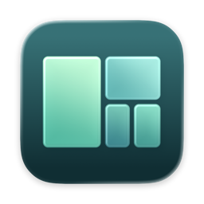

<p align="center"></p>
<h1 align="center">DiskSlop</h1>
<p align="center">See what’s taking up space on your Mac, down to the individual file.</p>
<p align="center">
  <a href="#install-on-macos"></a>
</p>
<p align="center">
  
  
</p>

DiskSlop reads file metadata in bulk with Rust. Click a tile or sunburst wedge to find the same item in a native, size-ranked folder tree.

## Install on macOS

Open a released `DiskSlop.dmg` and drag DiskSlop onto Applications. Each release with a disk image includes a SHA-256 checksum. While the first image is in preparation, you can build the app locally. [GitHub Releases](https://github.com/andrewlu0/diskslop/releases)

Installed copies can check for new stable releases using **DiskSlop → Check for Updates…**. In **Settings → Updates**, choose automatic checks and optionally install updates when quitting. Sparkle verifies the signed update feed and disk image. A copy built before the updater was added needs one manual installation. [Sparkle](https://sparkle-project.org/)

The app targets macOS 13 and later. The recorded native UI checks ran on macOS 27.0.1. A launch and folder-access check on macOS 13 is pending. [Recorded checks](BENCHMARKS.md)

With Rust and the macOS 26 SDK or later installed, run these commands from the repository directory.

```sh
./build-app.sh
open -a "$PWD/DiskSlop.app" "$PWD/mac"
```

This opens a small folder for a first scan. Click a tile to reveal its file in the tree, press **Space** to preview it, or press **⌘2** to see the same folder as a sunburst. Choose **Volume** for a mounted startup, external, or network volume, or **Choose Folder** for another directory. The volume picker can also show hidden system mounts. Scan scope follows the selected filesystem and the current user’s access.

The script builds the app and Rust CLI for your Mac’s processor. For an allocated-byte total in Terminal, run `target/release/diskslop --summary /path/to/folder`. To create a drag-to-install disk image, see [Packaging for macOS](docs/RELEASING.md).

Local builds use the available Apple Development certificate. Set `DISKSLOP_SIGN_IDENTITY` to choose a particular signing identity. Without a development certificate the script uses ad-hoc signing, which can cause macOS to ask for folder access again after rebuilding.

The app includes license and copyright notices in its Resources directory. [Third-party notices](THIRD-PARTY-NOTICES.txt)

Automatic scans use up to three quarters of the available physical cores, capped at eight workers and with a minimum of one. Scans recheck macOS thermal pressure and Low Power Mode during traversal and index construction. Background scan workers use utility priority.

## Navigate the map

Choose **Treemap** (⌘1) or **Sunburst** (⌘2) in the header. In the sunburst, the inner ring contains the current folder’s immediate children. The angle of each wedge shows its share of allocated space. Click a wedge to select and reveal that exact file or folder in the outline, double-click a folder to explore it, and click the center to go up. The number of rings adapts to the window. Drilling into a folder brings smaller descendants into view. A folder wedge uses its group when available or follows the largest branch for its color.

A fresh scan opens directly in the normal workspace. The folder tree, selected map, and color legend grow as files are discovered. Expand a folder or select a shape while scanning. The **Largest Files** sidebar tab (⌘3) shows the 100 largest regular files discovered so far and keeps the map and legend visible. Press **Space** for Quick Look or use **Open in Finder** in the action bar. After scanning, exploring a folder scopes the ranking to its contents.

Turn on **Live** in the header to watch the folder tree, Largest Files, the color legend and the active map update as files change. Size and count cells briefly tint green for increases, amber for decreases and the accent color for new rows. The switch remembers your choice. Local volumes use filesystem events. Volumes without an event stream use periodic background scans, spaced farther apart when a scan takes longer. Reduce Motion shows updated values and geometry immediately.

On the startup volume, Live periodically saves the latest displayed inventory and its filesystem event ID to the same compressed cache used when opening the app. Reopening replays changes made since that checkpoint, including edits made while DiskSlop was closed. Live batches cache writes in the background, normally after 15 minutes of changes and sooner during sustained activity. It counts the cache’s own disk use and suppresses writebacks triggered solely by that cache. A pending write can be skipped when space is tight or the app quits. The previous checkpoint remains available for replay.

| Gesture | Result |
| --- | --- |
| Click a file tile | Expands its ancestors, selects the exact file, scrolls to its outline row, and shows its allocated size. |
| Hover a tile or outline row | Shows its full path in the top header and highlights its group in the right sidebar. A tile’s tooltip includes its timestamp in a date view. |
| Click a folder in the outline | Highlights the contiguous footprint of its files, including nested descendants. |
| Show Parent Folder | Selects the enclosing folder of a single file or folder in the tree and highlights its contents in either map. Use the footer button or the row’s context menu. Repeated clicks move up to the scan root. During a fresh scan the button remembers the selected file’s parent and reveals it when the index is ready. |
| Back and Forward, or ⌘[ and ⌘] | Restores a previous or next selection from the outline or map, along with its folder and zoom. A new selection starts a new branch. |
| ⌘↓ or double-click a folder | Opens the selected folder in the map. |
| ⌘↑ | Opens the enclosing folder within the scan and selects the folder you just left. |
| Click the glass zoom buttons or press ⌘+ / ⌘− | Magnifies or reduces the map. |
| Command-scroll or pinch | Zooms around the pointer. Normal scrolling or Option-drag pans a magnified map. |
| Double-click a tile, or press ⇧⌘F | Fits the selected file or folder footprint. ⌘0 restores the overview. |
| Control-click or Command-click | Adds or removes an item from the selection. |
| Escape, ⌥⌘A or Edit → Deselect All | Clears the selection and restores the full brightness of both maps. Back restores the selection. |
| Shift-click | Selects a range in visible outline order. Adding Command or Control extends the existing selection. |
| Drag on the map or in the outline | Selects the files intersecting a rectangle, or a contiguous run of outline rows. |
| Right-click | Opens a native menu with Open, Open With, Open in Finder, Refresh, and Move to Trash. |

Table text is centered vertically. Names, kinds and counts align left. Sizes align right in the last column. Both sidebars reserve room for the entire size and the vertical scrollbar. Hovering, scrolling, and expanding or collapsing a folder preserve column widths. The file outline, file-kind legend, and mounted-volume picker use native inset tables with rounded surfaces. On macOS 26 and later each table shares one Liquid Glass background across all its rows. The folder chooser uses the system Open panel.

File opens folders (⌘O), lists mounted volumes (⇧⌘O), scans Home (⇧⌘H), and refreshes a scan (⌘R) or its selection. Edit copies selected file URLs (⌘C) or their pathnames as text (⌥⌘C). Select All (⌘A) selects the rows inside the folder displayed on the map, including expanded rows offscreen. View includes map zoom, toolbar visibility (⌥⌘T), and full screen (⌃⌘F). Window provides the standard window commands and a list of open windows.

Open in Finder, Show Parent Folder, and Move to Trash share the footer below the map. Open in Finder opens a single selected folder or reveals the selected files or folders.

A single selected file or folder moves directly to Trash. Selecting multiple rows or a range opens a review sheet with paths, allocated bytes and descendant counts. Return and Escape cancel the review. A folder includes its descendants once. The Rust backend protects complete scanned volumes, home folders and folders containing nested mounts. A multiple selection covering at least half the scanned bytes of a volume or home folder needs an extra acknowledgment in the sheet.

Selected cells stay at full brightness while the surrounding chart dims slightly. After a successful move, the visible tiles or wedges shed tiny sparks with white-hot centers and halos in the original color. Some split into finer dust close to the surface. The rest shrink and fade along their path to the Dock’s Trash. Reduce Motion uses a brief stationary glow.

DiskSlop uses the native Trash operation under the signed-in account’s permissions. A macOS refusal leaves the affected item in place. The app reports partial results and offers **Show in Finder** for the first affected item. Finder then handles any separate action you choose there.

## Layout and scan behavior

The layout applies the squarified treemap algorithm independently within each directory. Each file has a square-cornered rectangle. Folders supply geometric bounds for grouping and selection. Allocated bytes determine area. Each zero-allocation entry gets one byte of *visual weight* so it can be found under magnification. The size column always shows its actual allocated bytes. Empty folders and directory metadata take no map area. At overview scale a folder smaller than one physical pixel is drawn as a single tile. Zooming in builds its child rectangles on demand. Selecting a file from the outline also resolves the rectangles along its path. [Squarified Treemaps, Bruls, Huizing and van Wijk](https://research.tue.nl/en/publications/squarified-treemaps/)

Use **Color by** in the right sidebar or **View → Color By**. The app remembers the choice. Switching recolors the current layout in the background and preserves the selection and zoom. The legend shows each group’s file count and allocated size. Click a heading to sort. The available breakdowns follow GrandPerspective’s display options. [GrandPerspective display options](https://grandperspectiv.sourceforge.net/HelpDocumentation/ViewDisplayPanel.html)

| Color by | What shares a color |
| --- | --- |
| File Kind | A Finder kind. Applications and other recognized packages count once and tint their contents. Enter a package to see its internal kinds. |
| Creation Date, Last Modified, Last Accessed | Age from the filesystem timestamp to scan completion, in bands from the past 24 hours to ten years or older. Warm colors show recent files and cool colors show older files. Future and unavailable dates have separate rows. Access-time accuracy depends on how often the volume records reads. |
| Folder | Files directly inside the same containing folder. Paths in the legend are relative to the current map root. |
| Top-Level Folder | All descendants of the same immediate subfolder. Files at the map root appear under **This folder**. |
| File Extension, File Name | A case-insensitive final extension, or an exact filename including its extension. Extensionless files have their own row. |
| Folder Depth | The number of folder levels beneath the current map root. |
| Allocated Size | Actual disk allocation, from zero bytes to one terabyte or more. |

File Kind is the default. The scanner resolves representative items using their URL content type and Finder metadata, including types declared by installed applications. Other modes count individual file entries, including files inside packages. Ordinary directory metadata contributes to the scan total. Dates are captured to the minute during metadata enumeration. Color changes read the in-memory index, and legend rows format their text as they become visible. [Apple’s Uniform Type Identifiers](https://developer.apple.com/documentation/uniformtypeidentifiers/uttype-swift.struct)

Both maps use the same base color as the legend swatch and the solid part of its duotone icon. Light mode uses deeper shades and dark mode uses brighter shades. A soft glaze and fine edge reflections separate neighboring items, including small cells of the same color. The reflections run vertically on the square tiles and radially across the sunburst rings. The primary color stays visible through the middle of each surface. Labels use contrasting ink. Selection draws a one-physical-pixel outline on its own layer. Rust caches each color ramp and rasterizes the visible treemap tiles off the main thread. The sunburst draws a gradient once per visible color per ring. Reduce Transparency uses solid fills and fine separators on both maps.

The tree reuses native AppKit rows and preordered child indexes. Visible rows load their actual Finder icons on a bounded background queue and reuse a path-keyed cache. The glass legend pairs a map swatch with a tinted Nucleo duotone glyph. The entire app follows the system appearance by default. Choose **DiskSlop → Settings…** (⌘,) for Light or Dark. [Finder icons via NSWorkspace](https://developer.apple.com/documentation/appkit/nsworkspace/icon(forfile:)) · [Nucleo icons](https://nucleoapp.com/)

The scanner requests metadata through Darwin’s bulk directory API with a descriptor-based fallback. It counts each hard-linked allocation once, measures sparse files by their allocated blocks, skips Trash directories and stays within the selected mount. Symlinks are listed without traversing their targets. The status bar reports read errors and skipped mount boundaries. APFS clones can share storage, so the reported allocation can differ from space recovered after emptying Trash. [Apple’s bulk directory API](https://github.com/apple-oss-distributions/xnu/blob/main/bsd/man/man2/getattrlistbulk.2)

The first scan of **Startup disk · Data** also saves an index in `~/Library/Caches/local.diskslop.app/ScanIndex/`. When you quit and reopen the volume, DiskSlop loads it, replays the volume’s filesystem event journal, and rereads affected directories and directories that previously had read errors. A write to an existing nested file is covered even when the top-level folder’s modification date stays the same. If the index is damaged, the volume identity changes, or macOS reports incomplete history, DiskSlop starts a full scan. The private Zstandard-compressed file stores names and scan metadata. File contents and map geometry are excluded.

Recent roots stay in memory while the app is open. DiskSlop keeps up to three, targeting 512 MiB of estimated scan and geometry storage. A single larger scan can occupy the cache on its own. Reopen, **Rescan** (⌘R), and the toolbar refresh validate the root identity and local filesystem event history. A clean refresh keeps the current map, outline, selection and zoom. Multiple file edits in one directory require one directory listing. Ordinary file edits share the previous snapshot’s unchanged metadata and child indexes, and update ancestor totals. Directory topology and hard-link changes use the subtree reconciliation path. Refresh Selection also uses the watcher when available. When a local scan was partial, Rescan rereads the directories that had errors along with changes reported by the filesystem. Network mounts and lost event history use a fresh scan. Choose **File → Force Full Scan** (⇧⌘R) to reread everything. [Apple’s filesystem event guide](https://developer.apple.com/library/archive/documentation/Darwin/Conceptual/FSEvents_ProgGuide/UsingtheFSEventsFramework/UsingtheFSEventsFramework.html)

[Performance measurements and Disk Inventory X comparison](BENCHMARKS.md)
