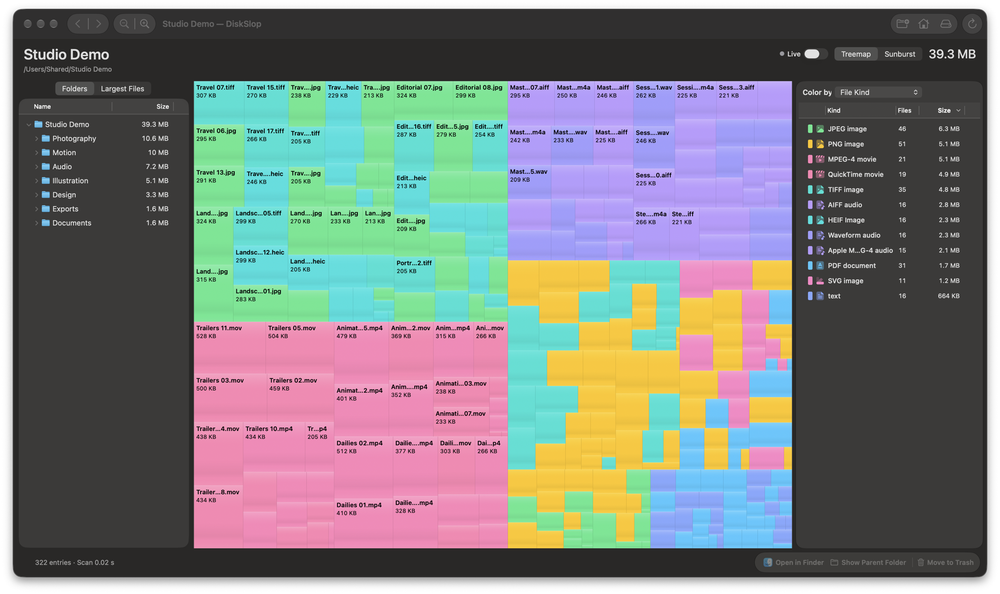
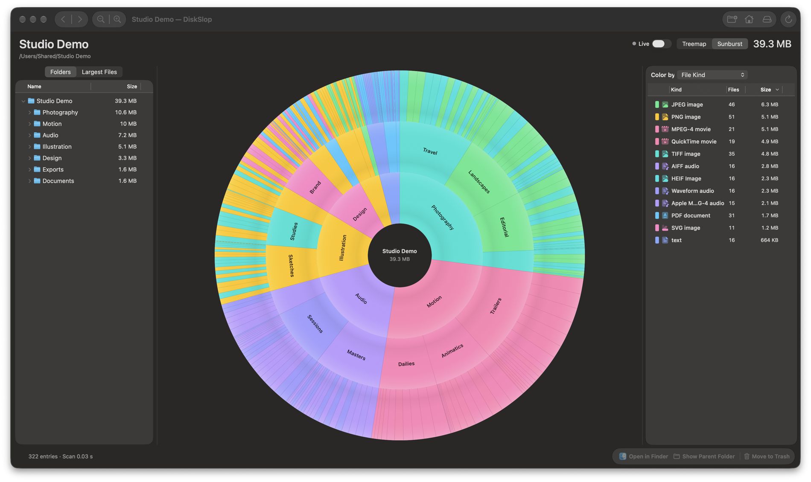

<p align="center"></p>
<h1 align="center">DiskSlop</h1>
<p align="center">See what’s taking up space on your Mac and connected drives.</p>
<p align="center">
  <a href="https://github.com/andrewlu0/diskslop/releases/latest/download/DiskSlop.dmg"></a>
</p>

```sh
brew install --cask andrewlu0/tap/diskslop
```

<p align="center">
  
  
</p>



## Features

- Click a tile or sunburst segment to reveal it in the folder tree.
- Find the largest files, or color the map by kind, folder, or date.
- Turn on **Live** to see files grow and shrink.
- Preview files with **Space**, reveal them in Finder, or move them to Trash.



## Install on macOS

Open the DMG and drag DiskSlop to Applications. Choose **DiskSlop → Install Terminal Command** to use `diskslop` in Terminal. Homebrew installs the command automatically.

```sh
diskslop --top 10 .
diskslop --json .
diskslop open .
```

The CLI scans the folder and lists its largest immediate children by allocated bytes. Use `--summary` for totals alone. JSON includes the entry count, allocated bytes, scan errors, mount boundaries, elapsed seconds, and the ranked children. A partial scan still prints its results and exits with a nonzero status. `diskslop open .` opens the current directory in the graphical app.

To build from source, use Rust and the macOS 26 SDK or later.

```sh
./build-app.sh
open DiskSlop.app
```

[Benchmarks](BENCHMARKS.md) · [Third-party notices](THIRD-PARTY-NOTICES.txt)

## License

DiskSlop’s original code is available under the [MIT License](LICENSE). The Nucleo icons and other third-party components retain their respective [licenses and notices](THIRD-PARTY-NOTICES.txt).
